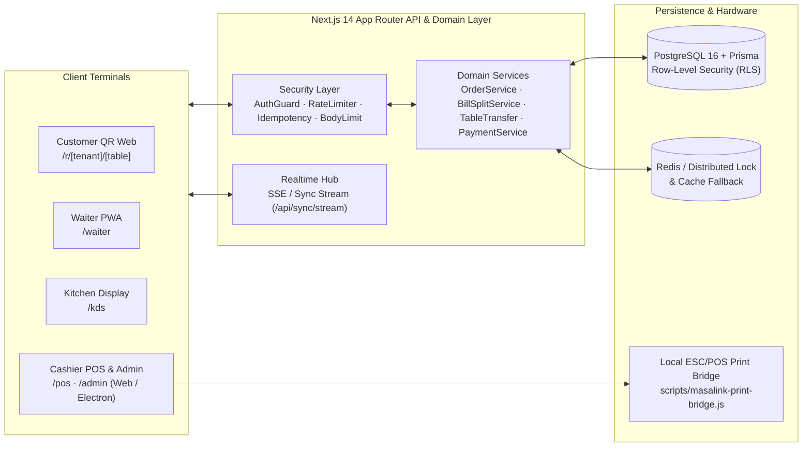

# MasaLink — Multi-Tenant Cloud Restaurant POS, QR Ordering & KDS Ecosystem

**MasaLink** is a full-stack, multi-tenant restaurant operating system built with **Next.js 14 (App Router)**, **TypeScript**, **Prisma**, and **PostgreSQL**. It unifies QR table ordering, a real-time Kitchen Display System (KDS), a mobile Waiter PWA terminal, a cashier POS checkout cockpit, gram-level recipe/inventory deduction, and a local ESC/POS thermal printer bridge.

---

## Overview

Traditional restaurant POS setups rely on proprietary hardware, disconnected kitchen printers, and high-commission third-party ordering tablets. MasaLink replaces fragmented tooling with a unified web and desktop kiosk platform featuring strict tenant isolation, cryptographic QR session tokens, idempotent order submission, and sub-second synchronization across table, waiter, kitchen, and cashier roles.

---

## Key Features & Operational Workflows

### 1. Customer QR Table Ordering (`/r/[tenantSlug]/[tableId]`)
- **Cryptographic Table Sessions (`src/utils/qrSecurityEngine.ts`, `src/utils/tableSessionRegistry.ts`):** Validates table tokens, prevents unauthorized remote order injection, and detects stale ("ghost") table sessions.
- **Idempotent Order Submission (`/api/qr-order`):** Prevents duplicate orders during unstable mobile network conditions using `IdempotencyService`.
- **Multi-Guest Cart & Modifiers:** Supports portion variations, cooking preferences, extra ingredients, and per-guest item attribution.

### 2. Kitchen Display System — KDS (`/kds`)
- **Station Routing & Live Timers:** Filters incoming tickets across kitchen stations (Grill/Hot, Oven/Pizza, Bar) with SLA countdown timers (`Preparing -> Ready -> Served`).
- **Audio & Visual Alerts:** Configurable kitchen buzzer/siren alerts for incoming and overdue tickets.

### 3. Waiter Service Terminal PWA (`/waiter`)
- **Floor Plan & Table State:** Real-time occupancy, active bill totals, and table transfer/merge operations (`/api/tables/transfer`).
- **Offline-Resilient Drafts (`src/utils/waiterDraftStorage.ts`):** Local draft persistence and server-side audit logging (`/api/waiter/draft`).

### 4. Cashier POS & Admin Cockpit (`/pos`, `/admin`)
- **Flexible Bill Splitting (`src/server/services/billSplitService.ts`):** Equal per-guest split or item-by-item partial checkout (`/api/tables/payment`).
- **Payment Provider Adapters (`src/server/payment/`):** Modular payment service with Iyzico (`iyzicoProvider.ts`) and PayTR (`paytrProvider.ts`) webhook/callback verification.
- **Automated Recipe & Stock Deduction (`MenuRecipeModule.tsx`):** Deducts raw ingredient quantities per sold item based on defined bill-of-materials recipes.
- **Interactive Role Simulator (`/demo` & Landing Page):** Synchronized in-browser playground demonstrating QR Ordering, KDS, and POS interactions alongside a dynamic ROI calculator.

### 5. Local Hardware & Kiosk Integration
- **ESC/POS Thermal Print Bridge (`scripts/masalink-print-bridge.js`):** Local Node.js daemon (`npm run bridge`) that relays receipt print jobs to LAN/USB thermal printers with a failed-print retry queue.
- **Electron Kiosk Mode (`desktop/main.js`):** Dedicated desktop wrapper (`npm run desktop:kiosk`) for touch-screen POS terminals.

---

## Architecture & Tech Stack



### Tech Stack
- **Frontend:** Next.js 14.2 (App Router), React 18, TypeScript 5.6, Tailwind CSS 3.4, Framer Motion, Lucide React
- **Backend & API:** Next.js Route Handlers (`src/app/api/*`), PBKDF2/bcrypt password & PIN hashing, sliding-window rate limiting, strict request body size guards
- **Database & ORM:** PostgreSQL 16 (`docker-compose.yml`), Prisma ORM 6.19 with multi-tenant Row-Level Security (`prisma/migrations/`)
- **Desktop & Hardware:** Electron (`desktop/`), Node.js TCP/ESC-POS Print Bridge (`scripts/`)
- **Testing:** Node.js native test runner via `tsx --test` (`tests/*.test.ts`)

---

## Directory Structure

```text
MasaLink/
├── prisma/                     # Prisma schema, SQL migrations (including RLS), and seed data
├── public/                     # Static PWA manifests (main & waiter), service worker, and brand icons
├── desktop/                    # Electron main & preload scripts for POS kiosk deployment
├── scripts/                    # Database backup/restore scripts, ESC/POS Print Bridge & manual verifiers
│   └── verify/                 # Standalone scenario verification scripts
├── src/
│   ├── app/                    # Next.js App Router pages (/admin, /pos, /kds, /waiter, /r/..., /api/*)
│   ├── components/             # UI components, interactive simulator, and admin modules
│   ├── server/                 # Backend repositories, tenant RLS context, Redis locks, payment & security
│   └── utils/                  # Auth helpers, QR security engine, concurrency locks & sync utilities
├── tests/                      # 17 automated unit, security, and integration test suites
├── Dockerfile                  # Multi-stage production Node 20 Alpine container build
├── docker-compose.yml          # Local PostgreSQL 16 service definition
└── .env.example                # Documented environment variable template
```

---

## Installation & Local Development

### Prerequisites
- **Node.js:** v20+ (LTS recommended)
- **Docker & Docker Compose:** For running the local PostgreSQL 16 database

### Step-by-Step Setup

1. **Clone the repository and install dependencies:**
   ```bash
   git clone https://github.com/mert-carli/MasaLink.git
   cd MasaLink
   npm install
   ```

2. **Configure environment variables:**
   Copy `.env.example` to `.env` and adjust values as needed for local development:
   ```bash
   cp .env.example .env
   ```

3. **Start the PostgreSQL container and initialize the database:**
   ```bash
   npm run db:up
   npm run db:migrate
   npm run db:seed
   ```
   *(Note: The application also supports an automatic local demo/fallback mode when inspecting the interactive UI without a live PostgreSQL instance.)*

4. **Start the development server:**
   ```bash
   npm run dev
   ```
   Open `http://localhost:3000` in your browser.

5. **Optional — Start the Local Thermal Print Bridge:**
   ```bash
   npm run bridge
   ```

---

## Configuration (`.env.example`)

All environment variables are validated at startup via `src/server/config/envValidator.ts`. Key configuration groups in [`.env.example`](./.env.example):
- `DATABASE_URL` — PostgreSQL connection string
- `JWT_SECRET` & `QR_TOKEN_SECRET` — Cryptographic signing keys (minimum 32 characters in production)
- `REDIS_URL` — Optional Redis connection for distributed locking and rate limiting (gracefully falls back to in-memory locking in local development)
- `PAYMENT_PROVIDER`, `IYZICO_*`, `PAYTR_*` — Payment gateway credentials

---

## Testing

MasaLink includes **17 automated test suites** in [`tests/`](./tests) covering authentication security, multi-tenant isolation, QR order idempotency, concurrency/payment locks, rate limiting, and backup resilience:

```bash
npm test
```

Standalone scenario verification scripts are located under [`scripts/verify/`](./scripts/verify) (e.g., `npx tsx scripts/verify/test-order-service.ts`).

---

## Docker Production Build

A hardened, multi-stage `Dockerfile` running as a non-root `nextjs` user with a built-in `/api/health?type=live` probe is included:

```bash
docker build -t masalink-app .
```

---

## Author

**Mevlana Mert Çarlı**  
- GitHub: [@mert-carli](https://github.com/mert-carli)  
- Portfolio: [mert-carli-cvu9.vercel.app](https://mert-carli-cvu9.vercel.app)
